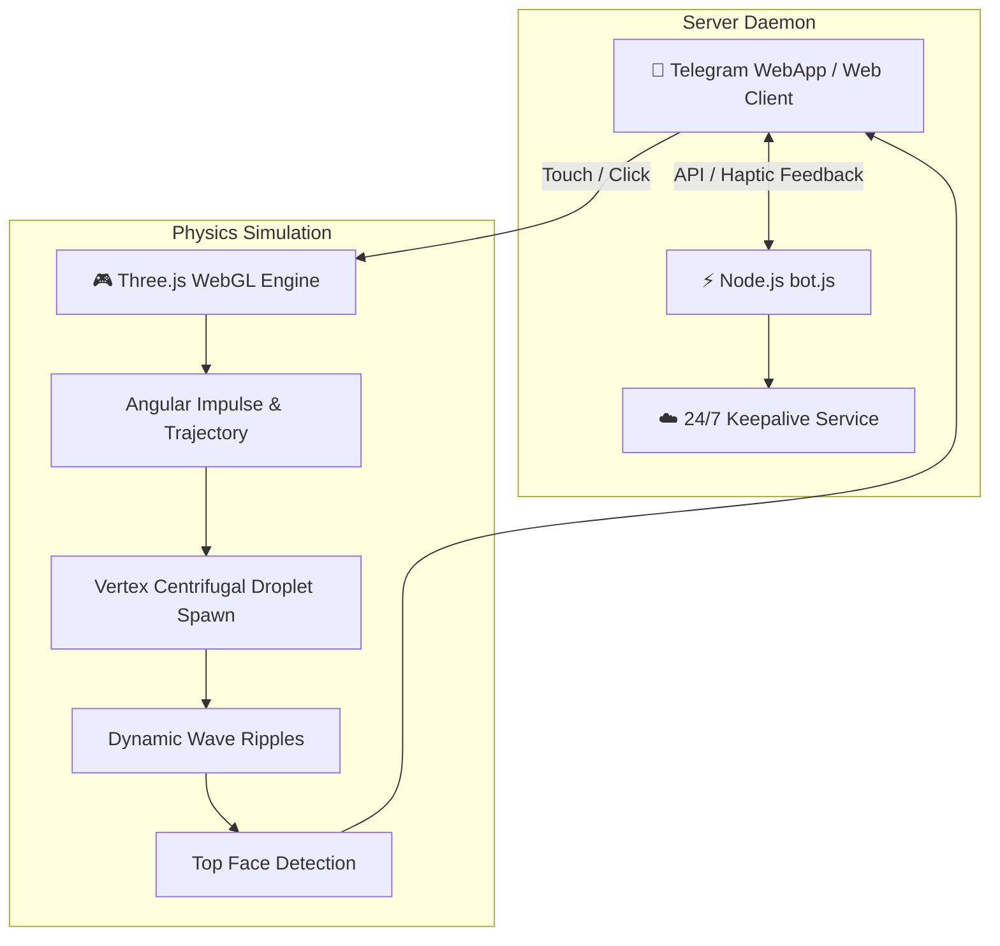

<div align="center">

# 🎲 3D Interactive WebGL Dice Physics Simulation & Telegram Mini App

**Interactive cross-platform WebGL 3D application and Telegram Mini App featuring custom rigid-body physics, procedural water simulation ("Moon Lagoon"), centrifugal spray dynamics, and automated Blender modeling.**

[](https://developer.mozilla.org/)
[](https://threejs.org/)
[](https://nodejs.org/)
[](https://www.blender.org/)
[](LICENSE)

[🇷🇺 Читать на русском](README.md) • [🇬🇧 Read in English](README.en.md)

---

</div>

## 📑 Table of Contents

1. [Project Overview](#1-project-overview)
   * [1.1. Concept](#11-concept)
   * [1.2. Engineering Challenges](#12-engineering-challenges)
2. [Key Features & Physics Modeling](#2-key-features--physics-modeling)
   * [2.1. 3D Rigid-Body Dice Physics (Three.js)](#21-3d-rigid-body-dice-physics-threejs)
   * [2.2. Fluid Dynamics & Centrifugal Spray Particles](#22-fluid-dynamics--centrifugal-spray-particles)
   * [2.3. Procedural Blender 3D CAD Generation](#23-procedural-blender-3d-cad-generation)
   * [2.4. Telegram Mini App & 24/7 Cloud Daemon](#24-telegram-mini-app--247-cloud-daemon)
3. [Architecture & Workflow](#3-architecture--workflow)
   * [3.1. Flowchart](#31-flowchart)
   * [3.2. File Hierarchy](#32-file-hierarchy)
4. [Technology Stack](#4-technology-stack)
5. [Installation & Local Setup](#5-installation--local-setup)
6. [Author & Contacts](#6-author--contacts)

---

## 1. Project Overview

### 1.1. Concept
**3D Interactive Dice Simulation** is a WebGL experience deployable as a standalone browser web app and embedded within a Telegram Mini App. It delivers a fluid decision oracle interface backed by physically realistic body-fluid interactions.

### 1.2. Engineering Challenges
* **Mobile WebGL Optimization:** Sustaining stable 60 FPS within mobile webviews while concurrently simulating hundreds of particle physics entities.
* **Surface Hydrodynamics:** Recreating dynamic capillary wave dispersion (ripples) combined with liftoff droplets separating from 3D vertices under centrifugal torque.

---

## 2. Key Features & Physics Modeling

### 2.1. 3D Rigid-Body Dice Physics (Three.js)
* Velocity integration accounting for gravity, angular friction damping, and elastic collision coefficients.
* Raycasting and normal evaluation routines calculating the exact landing face.

### 2.2. Fluid Dynamics & Centrifugal Spray Particles
* **Moon Lagoon Surface:** Custom dark reflective shader mimicking still water bodies at night.
* **Centrifugal Droplet Separation (`spawnLiftoffSpray`):** On rapid ascension, water droplets launch tangentially from all 8 vertices of the spinning cube.
* **Attenuating Waves:** Concentric wave propagation generated upon surface collision.

### 2.3. Procedural Blender 3D CAD Generation
* Python automation via `generate_blender_dice.py` within the Blender API:
  * Parametric edge beveling;
  * Embossed numeric/symbolic engravings;
  * PBR surface tuning (Metallic Sapphire roughness and normal maps);
  * Optimized binary `dice.glb` asset export.

### 2.4. Telegram Mini App & 24/7 Cloud Daemon
* Node.js server daemon (`bot.js`) interfacing with the Telegram Bot API;
* Continuous 24/7 uptime monitoring protocol tailored for PaaS (Render.com).

---

## 3. Architecture & Workflow

### 3.1. Flowchart



### 3.2. File Hierarchy

```text
├── кубик-судьбы.html       # Standalone 3D WebGL runtime (Three.js + Shaders)
├── bot.js                  # Telegram Mini App server daemon
├── dice.glb                # Optimized PBR 3D asset
├── generate_blender_dice.py# Procedural Blender Python generator
├── package.json            # Node.js dependencies and scripts
├── README.md               # Russian documentation
└── README.en.md            # English documentation
```

---

## 4. Technology Stack

* **Frontend & 3D:** `Three.js`, `WebGL`, `HTML5 Canvas`, `GLSL Shaders`
* **3D Modeling:** `Blender Python API`, `glTF/GLB Pipeline`
* **Backend:** `Node.js 18+`, `node-telegram-bot-api`
* **Hosting:** `Render.com` / Cloudflare Tunnels

---

## 5. Installation & Local Setup

```bash
# Clone repository
git clone https://github.com/Andrew123485/kubik555-bot.git
cd kubik555-bot

# Install dependencies
npm install

# 1. Run Telegram Bot
npm start

# 2. Run local web server for 3D interface:
npx serve .
```

---

## 6. Author & Contacts

* **Author:** Andrei Vladimirov
* **Specialization:** Business Analyst / Fintech Developer
* **Telegram:** [@amorfatimementomoria](https://t.me/amorfatimementomoria)
* **GitHub:** [github.com/Andrew123485](https://github.com/Andrew123485)
