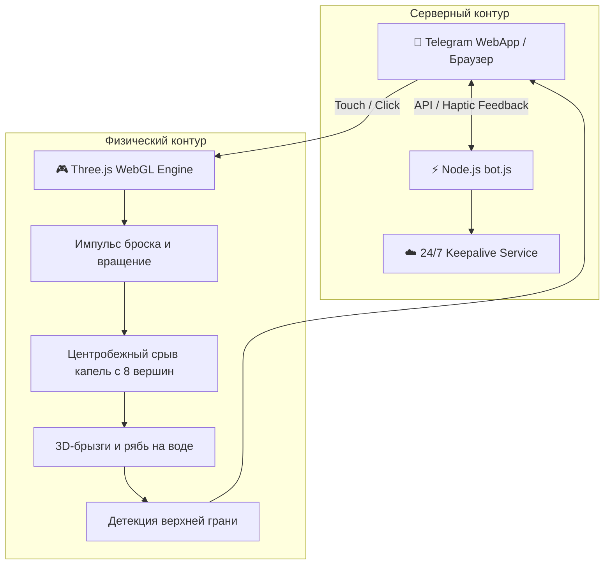

<div align="center">

# 🎲 3D Interactive WebGL Dice Physics Simulation & Telegram Mini App

**Интерактивное 3D-веб-приложение и Telegram Mini App с кастомной физикой свободного вращения, шейдерной водной гладью «Лунная лагуна», 3D-брызгами и процедурным моделированием в Blender.**

[](https://developer.mozilla.org/)
[](https://threejs.org/)
[](https://nodejs.org/)
[](https://www.blender.org/)
[](LICENSE)

[🇷🇺 Читать на русском](README.md) • [🇬🇧 Read in English](README.en.md)

---

</div>

## 📑 Содержание

1. [Обзор проекта](#1-обзор-проекта)
   * [1.1. Концепция](#11-концепция)
   * [1.2. Решаемые инженерные вызовы](#12-решаемые-инженерные-вызовы)
2. [Ключевые возможности и физика](#2-ключевые-возможности-и-физика)
   * [2.1. 3D-физика броска кубика (Three.js)](#21-3d-физика-броска-кубика-threejs)
   * [2.2. Водная гладь «Лунная лагуна» и система 3D-брызг](#22-водная-гладь-лунная-лагуна-и-система-3d-брызг)
   * [2.3. Процедурная генерация 3D-модели (Blender Python API)](#23-процедурная-генерация-3d-модели-blender-python-api)
   * [2.4. Интеграция с Telegram Mini App и 24/7 Cloud Daemon](#24-интеграция-с-telegram-mini-app-и-247-cloud-daemon)
3. [Архитектура решения](#3-архитектура-решения)
   * [3.1. Схема взаимодействия](#31-схема-взаимодействия)
   * [3.2. Файловая структура](#32-файловая-структура)
4. [Стек технологий](#4-стек-технологий)
5. [Установка и локальный запуск](#5-установка-и-локальный-запуск)
6. [Автор и контакты](#6-автор-и-контакты)

---

## 1. Обзор проекта

### 1.1. Концепция
**3D Interactive Dice Simulation** — интерактивное кроссплатформенное WebGL-приложение, работающее как автономно в браузере, так и внутри Telegram Mini App. Сервис позволяет генерировать случайные решения и проводить интерактивные сессии («Оракул решений») с кинематографичной физикой взаимодействия твердых тел и флюидов.

### 1.2. Решаемые инженерные вызовы
* **Производительность на мобильных устройствах:** Достижение стабильных 60 FPS на смартфонах внутри Telegram WebApp без просадок кадров при физических расчетах сотен частиц воды.
* **Реалистичная гидродинамика:** Моделирование поверхностных волн (ряби) и отрыва микрокапель от вершин вращающегося кубика под действием центробежной силы.

---

## 2. Ключевые возможности и физика

### 2.1. 3D-физика броска кубика (Three.js)
* Расчет траектории подбрасывания с учетом гравитации, затухания угловой скорости (angular damping) и упругого отскока от поверхности.
* Алгоритм автоматического позиционирования верхней грани (Raycasting & Face Normal Evaluation) для однозначного определения выпавшего значения.

### 2.2. Водная гладь «Лунная лагуна» и система 3D-брызг
* **Темная зеркальная гладь:** Шейдерный материал с отражениями, моделирующий ночную водную поверхность.
* **Центробежный срыв капель (`spawnLiftoffSpray`):** При резком взлете кубик увлекает веер светящихся капель, срывающихся напрямую с 8 геометрических вершин трехмерного объекта.
* **Динамическая рябь:** Распространение затухающих концентрических колец при контакте кубика с поверхностью воды.

### 2.3. Процедурная генерация 3D-модели (Blender Python API)
* Скрипт `generate_blender_dice.py` автоматизирует моделирование геометрии кубика через Blender API:
  * Фаски граней (Bevel modifiers);
  * Нанесение символов и гравировки;
  * PBR-текстурирование (Metallic Sapphire roughness/normal maps);
  * Экспорт в бинарный формат `dice.glb` с минимальным размером.

### 2.4. Интеграция с Telegram Mini App и 24/7 Cloud Daemon
* Серверный демон `bot.js` на Node.js обрабатывает взаимодействие с Telegram Bot API;
* Поддержка непрерывного аптайма 24/7 на облачных PaaS (Render.com) через фоновый пинг-механизм (Keepalive).

---

## 3. Архитектура решения

### 3.1. Схема взаимодействия



### 3.2. Файловая структура

```text
├── кубик-судьбы.html       # Автономный WebGL 3D интерфейс (Three.js + Shaders)
├── bot.js                  # Серверный Telegram-бот и Mini App обработчик
├── dice.glb                # PBR 3D-модель кубика (оптимизированный GLTF)
├── generate_blender_dice.py# Скрипт процедурного моделирования в Blender
├── package.json            # Манифест зависимостей Node.js
├── README.md               # Документация на русском
└── README.en.md            # English documentation
```

---

## 4. Стек технологий

* **Frontend & 3D:** `Three.js`, `WebGL`, `HTML5 Canvas`, `GLSL Shaders`
* **3D Моделирование:** `Blender Python API`, `glTF/GLB Pipeline`
* **Backend:** `Node.js 18+`, `Telegram Bot API`, `node-telegram-bot-api`
* **Хостинг:** `Render.com` / Cloudflare Tunnels

---

## 5. Установка и локальный запуск

```bash
# Клонирование репозитория
git clone https://github.com/Andrew123485/kubik555-bot.git
cd kubik555-bot

# Установка зависимостей
npm install

# 1. Запуск Telegram-бота
npm start

# 2. Локальный запуск 3D-интерфейса в браузере:
# Откройте файл кубик-судьбы.html через Live Server или любой локальный веб-сервер
npx serve .
```

---

## 6. Автор и контакты

* **Автор:** Владимиров Андрей Георгиевич
* **Специализация:** Бизнес-аналитик / Финтех-разработчик
* **Telegram:** [@amorfatimementomoria](https://t.me/amorfatimementomoria)
* **GitHub:** [github.com/Andrew123485](https://github.com/Andrew123485)
